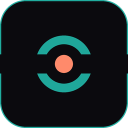
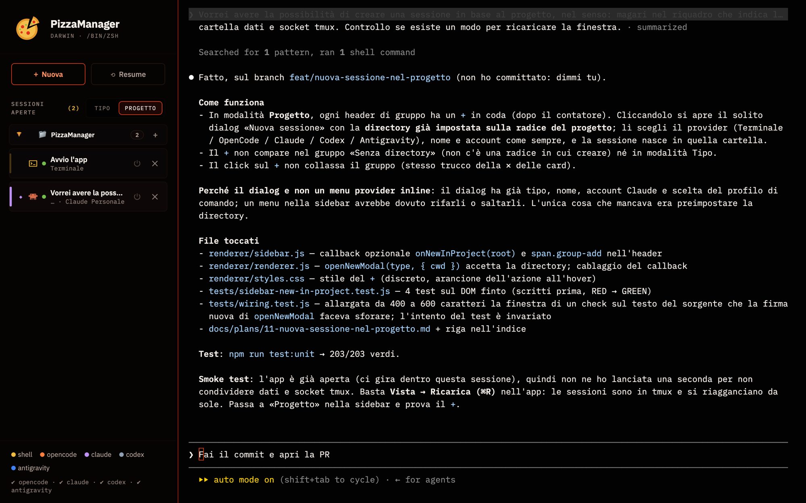

<p align="center">
  <a href="README.md">🇮🇹 Italiano</a> ·
  <b>🇬🇧 English</b>
</p>

<p align="center">
  
</p>

<h1 align="center">PizzaManager</h1>

<p align="center">
  All your Claude Code, Codex, OpenCode and terminal sessions in a single window.<br>
  Every tab is a real terminal. With tmux, sessions survive even when you close the app.
</p>

<p align="center">
  <a href="#installation">Installation</a> ·
  <a href="#what-it-does">What it does</a> ·
  <a href="#quick-start">Quick start</a> ·
  <a href="#configuration">Configuration</a> ·
  <a href="#when-something-goes-wrong">Troubleshooting</a> ·
  <a href="#development">Development</a>
</p>

<p align="center">
  <a href="https://github.com/ale-cadei/PizzaManager/releases/latest"></a>
  <a href="https://github.com/ale-cadei/PizzaManager/actions/workflows/ci.yml"></a>
  
  
  <a href="LICENSE"></a>
</p>

<p align="center">
  
</p>

> **Heads up: the app's interface is in Italian.** This page is translated, the
> app is not (yet). Below, the labels you'll see in the app are given in Italian,
> with the English in brackets. If that's a problem for you, say so in an issue:
> knowing somebody wants it is what would make it worth doing.

If you work with several AI agents from the terminal, you end up with ten windows open, none of them telling you what it's doing, and every so often you close one halfway through a task. PizzaManager puts them in a single window, with a sidebar that tells you **which agent, in which project, and whether it has finished**. No account, no service in between: it runs on your computer and launches the binaries you already have installed.

|  |  |
|---|---|
| 🍕 **One place for everything** | Terminal, [Claude Code](https://github.com/anthropics/claude-code), [Codex](https://github.com/openai/codex), [OpenCode](https://opencode.ai) and [Antigravity](https://antigravity.google) in tabs, each with its own icon |
| 🔥 **Sessions don't die** | With `tmux` every session lives outside the app: close the window, reopen it, it's still there. After a reboot it offers to restore them |
| 🗂 **Grouped the way you think** | By agent or by project (the repository root). A project's `+` opens a new session right there |
| 🔔 **You know when it's done** | A background tab blinks when the agent stops writing, and a system notification can follow: your turn |
| ◫ **Two at a time** | Two sessions on a split screen, side by side or one above the other |
| 📝 **Editor and notebooks** | A tab with the project tree and VS Code's editor (Monaco); Jupyter notebooks open, edit and run |
| 🌿 **Git and worktrees** | A branch map, branch switching, and a session inside its own `git worktree`: two agents on the same repo stop stepping on each other's files |
| 👁 **What it changed** | A panel with the `diff` of what the agent touched, updated while it works; staging, commits and conflicts without a terminal |
| ⟲ **Resume** | Pick up a Claude, Codex, OpenCode or Antigravity conversation from its list, with the right title, and search the text of past ones |
| 👤 **Several Claude accounts** | OAuth login plus extra API keys, or separate profiles via `CLAUDE_CONFIG_DIR`; you pick per session |
| ⚙️ **Your own commands** | For each type you can define several launch commands (`claude --model opus`, environment variables, and so on) |

## Installation

### Download

| | | |
|---|---|---|
| **macOS** | [Apple Silicon (.dmg)](https://github.com/ale-cadei/PizzaManager/releases/latest/download/PizzaManager-mac-arm64.dmg) · [Intel (.dmg)](https://github.com/ale-cadei/PizzaManager/releases/latest/download/PizzaManager-mac-x64.dmg) | Drag the app into *Applications* |
| **Linux** | [AppImage](https://github.com/ale-cadei/PizzaManager/releases/latest/download/PizzaManager-linux-x86_64.AppImage) · [.deb](https://github.com/ale-cadei/PizzaManager/releases/latest/download/PizzaManager-linux-amd64.deb) | `chmod +x` the AppImage, or `sudo dpkg -i` the .deb |
| **Windows** | `PizzaManager-win-x64-setup.exe` from [Releases](https://github.com/ale-cadei/PizzaManager/releases): the latest one that has it | unsigned installer; persistent sessions through psmux, bundled (see [On Windows](#on-windows)) |

All versions: [Releases](https://github.com/ale-cadei/PizzaManager/releases). Windows ships only when its tests pass: if the latest release doesn't have it, the package is in the previous one, and an installed app jumps straight to the next release that has it. The CLIs (`claude`, `codex`, `opencode`) are installed separately: the app launches whichever it finds on your PATH.

Not sure which Mac you have? → *About This Mac*: if it says "Apple M…" take **arm64**, if it says "Intel" take **x64**. On Linux the **AppImage** is the better choice: it is the only format that updates itself (the `.deb` is handled by `apt`).

The Releases page also carries `.zip`, `.blockmap` and `latest*.yml` files: those aren't for you, they are what the app uses to update itself.

### The first time you open it

- **macOS**: nothing to do. The `.dmg` is signed with a Developer ID and notarized by Apple, so it opens like any other downloaded app.
- **Linux**: nothing to do.
- **Windows**: the package is not signed, so SmartScreen shows a warning: *More info → Run anyway*.

### It updates itself

You don't need to come back here. The app checks for a new version on its own, downloads it while you work, and tells you **once it's done**: the banner at the top says the new version is ready, and *Riavvia ora* (Restart now) takes two seconds because the package is already on disk. Open sessions come back where they were. If it's a bad moment, *Più tardi* (Later) dismisses it and you'll find it again next time.

Two exceptions: with the `.deb`, updates stay with `apt` (the banner tells you and opens this page), and on Windows they come only with the releases that include Windows. The installed version is under **Help → Informazioni su PizzaManager** (About PizzaManager).

### From source

You need this if you want to change the app or try `main` before a release. An app built this way **does not update itself**: that is on purpose, and it is how the two of us run it while we develop it.

#### What you need

| | Required | Recommended |
|---|---|---|
| **All** | [Node.js](https://nodejs.org) 22 or newer | At least one of `claude`, `codex`, `opencode`, `agy` on your PATH |
| **macOS** | Xcode Command Line Tools (`xcode-select --install`, to compile `node-pty`) | `brew install tmux` |
| **Linux** | `build-essential` and `python3` (for `node-pty`) | `sudo apt install tmux` (or your distro's equivalent) |
| **Windows** | nothing else: `node-pty` uses its prebuilt binaries | `npm run fetch:psmux` |

Without `tmux` the app still works, but sessions die with the window. On Windows `tmux` isn't needed: the app carries [psmux](https://github.com/psmux/psmux), which does the same job. The package already contains it; from source, `npm run fetch:psmux` downloads it (once, with its SHA-256 checked).

To **run** notebooks you also need Python with `jupyter_client` and `ipykernel` (`pip install jupyter_client ipykernel`); opening and editing them doesn't.

#### Running it

```bash
git clone https://github.com/ale-cadei/PizzaManager.git
cd PizzaManager
npm install
npm start
```

`npm install` compiles `node-pty` for your platform: it is the only step that can fail, almost always because the compiler is missing (table above).

#### Installing it as a real app

```bash
npm run install:mac   # macOS: builds PizzaManager.app and copies it into /Applications
npm run install:win   # Windows: builds the setup and installs into %LOCALAPPDATA%\Programs, with a Start menu shortcut
npm run dist          # any system: the current platform's packages in dist/
```

A locally built app opens without warnings (Gatekeeper only checks downloaded files). Remember to rebuild it after every code update: it is a snapshot of that moment. And don't keep it open together with `npm start`: they would be two clients on the same tmux sessions.

## What it does

### Sessions

Every tab is a real terminal ([node-pty](https://github.com/microsoft/node-pty) + [xterm.js](https://xtermjs.org)): full-screen TUIs, 24-bit colour and shortcuts work as in your system terminal. **Nuova** (New, `⌘N` / `Ctrl+N`) asks for type, name and working directory; recently used directories are one click away. Besides terminals, the types include **Editor** and **Git** (below).

Text size is set from **Vista** (View, `⌘+` / `⌘-` / `⌘0`, or `Ctrl` elsewhere); it applies to every tab and is remembered.

A tab names itself: the first line you type, or the title the agent gives the conversation as soon as it saves it. The name chosen in **Nuova** also reaches the CLI (Claude through `--name`, and OpenCode). Double-click a tab to rename it; the name survives a restart, and Claude gets it at the next resume.

### Sessions outlive the app

With `tmux` installed, every session lives in PizzaManager's tmux server (its own `aisession` socket, so your personal tmux sessions are left alone). The app is just an attached client:

- **✕** detaches the tab: the process keeps going, and you find it when you reopen.
- **⏻** really ends it.
- After a **reboot** the app knows what was open and offers to restore it: conversations with a known id restart with `--resume`, the others as new sessions in the same directory.

You can also attach from any terminal: `tmux -L aisession ls`.

### Sidebar

Two ways of grouping, with a switch: **by type** (Claude, Codex, …) or **by project**, meaning the repository root. Groups open and close; tabs are reordered by dragging. In project mode every group has a `+` that opens the dialog with the directory already set, and **⤒** brings a group to the top of the list. The whole sidebar collapses to a column of icons, to leave room for the terminal.

The box under **Nuova** and **Resume** searches the messages of open Claude Code and Codex chats and the visible history of shells; clicking a result takes you to the tab. Every result shows its type and logo, and you can open all the matches found. The search in **Resume** also looks through closed conversations and lets you expand the matches. Spaces in the query count: `git ` finds `git `, but not `github`.

A background tab **blinks** when the agent has stopped writing for a second and a half (or rang the bell): no need to go and check. The **Vista** menu also turns on a system notification.

A bar shows **how much you've used** in the 5-hour window and in the week, and how long until the reset: for Claude it is the same quota as `/usage`, per account; for Codex, the one it writes in its own logs.

### Split screen

Drag a tab onto an edge of the area and the two sessions sit side by side (or one above the other). The line in between can be dragged, and a double-click puts it back in the middle; ⇄ swaps, ✕ removes. On restart the split comes back.

### Editor and notebooks

An **Editor** tab opens a project with the file tree on the left and [Monaco](https://microsoft.github.io/monaco-editor/), VS Code's editor, on the right:

- several files under **Aperti** (Open), `Ctrl+P` to jump to a file, a filter on the tree, git letters next to the files;
- lines changed since the last commit marked in the gutter and in the scrollbar; at the end of the cursor's line, who touched it and when;
- `Ctrl+click` (`⌘+click` on Mac) goes to the definition; a status bar with position, spaces, encoding, line endings and language;
- comments on lines, to copy as a prompt for the agent;
- Markdown files are shown rendered, with «▤ Anteprima» / «{ } Sorgente» (Preview / Source) in the header;
- files and folders are copied in by dragging them from Finder or your file manager.

An `.ipynb` opens as a **notebook**: Markdown, highlighted code, text output, images and tables. You edit it with Jupyter's keys (`A`/`B`, `D D`, `M`/`Y`/`R`, `Z`, `Enter`) and **run** it: `Ctrl+Enter` runs the cell, `Shift+Enter` runs it and moves to the next, «Esegui tutto» (Run all), ■ interrupts, ↻ restarts the kernel. The file stays in Jupyter's format. Without Python with `jupyter_client` and `ipykernel`, the notebook bar tells you what to install, and everything else still works.

### Git, worktrees and changes

A **Git** tab shows a repository's branch map and lets you switch branch, or merge any branch into the current one.

From a project's group you can open a session in a **worktree**: its own folder and branch, on the same repository. Two agents on the same project stop stepping on each other's files, and one's `git switch` doesn't change the files under the other's feet. The worktree shows up in the sidebar under the project, with its own ⟲ to resume only its chats; when the work is done you **merge** it, **keep** it as a branch for a PR, or **throw it away**.

The **Modifiche** (Changes) panel shows the `diff` of what the agent touched, updated while it works: staged and unstaged, stage, unstage and commit, discard a file (with Undo), open it in the editor at the first changed line. A merge, rebase, cherry-pick or revert left halfway switches to **Conflitti** (Conflicts) mode: the blocks show up in the editor and you pick which to keep with one click, then «Concludi merge» (Finish merge, or «Continua» for a rebase), or abort.

### Resume

**Resume** lists the conversations saved by each CLI, with title, directory and date, and reopens them with the right resume command:

| | Where it reads them | How it reopens |
|---|---|---|
| Claude Code | `~/.claude/projects/**/*.jsonl` | `claude --resume <id>` |
| Codex | `~/.codex/sessions/**/rollout-*.jsonl` | `codex resume <id>` |
| OpenCode | `opencode session list --format json` | `opencode --session <id>` |
| Antigravity | `~/.gemini/antigravity-cli/conversations` | `agy --conversation <id>` |
| History | the last 200 sessions opened from the app | same command, same directory |

### Claude accounts

The current OAuth login is picked up on its own. You can add accounts with an **API key** (⚙ in the dialog): keys stay on your disk, in a file only you can read, and reach the process only as `ANTHROPIC_API_KEY`. If you want two truly separate OAuth logins (work / personal), define a command like `CLAUDE_CONFIG_DIR=~/.claude-personal claude`: PizzaManager recognises the profile and shows it in the sidebar.

### Configurable commands

`File → Configurazione comandi…` (Command configuration, `⌘,` / `Ctrl+,`). Each session type can have several commands: name, command line, resume arguments with the `{id}` placeholder. With more than one command per type, it asks which one at launch. Leading variables (`VAR=value command`) and `$VAR` in arguments are expanded; so is `~`.

Commands run **without a shell**: no pipes, redirections or aliases. If you have an alias in `.zshrc`, write it out in full in the profile.

## Quick start

1. **Nuova** → pick *Claude*, a directory with a `.git`, confirm.
2. Type the first prompt: the tab takes that name.
3. Switch the sidebar to **Progetto** (Project): the tab is in the repository's group. Press the group's `+` to open a terminal in the same directory.
4. Close the app. Reopen it: with `tmux` the session is still there, with Claude halfway through its answer.
5. **Resume** → *Claude*: the conversation is in the list, even if you started it from a terminal and not from here.

## Configuration

Everything lives in the app's data folder, which **doesn't change** even if the app is renamed:

| System | Folder |
|---|---|
| macOS | `~/Library/Application Support/AISessionManager` |
| Linux | `~/.config/AISessionManager` |
| Windows | `%APPDATA%\AISessionManager` |

| File | Contents |
|---|---|
| `command-profiles.json` | the launch commands (also editable from the UI) |
| `claude-accounts.json` | the API key accounts — permissions `600` |
| `sessions-history.json` | the last 200 sessions opened (for Resume and recent directories) |
| `live-sessions.json` | a mirror of the live tmux sessions, for restoring after a reboot |

### What goes over the network

No telemetry and no account. These are the requests the app makes on its own, and none of them sends your files or your conversations:

- the **fonts** (IBM Plex Mono and IBM Plex Sans from Google Fonts; offline it falls back to the system ones);
- the **update check** against GitHub Releases, 10 seconds after startup and then every 4 hours;
- the **Claude quota** for the usage bar, asked of Anthropic with the token the CLI has already saved (at most every 5 minutes per account);
- the list in the **Segnalazioni** (Feedback) panel, read from the repository on GitHub.

Everything else is the CLIs you launch yourself.

### On Windows

It works with PowerShell as the terminal and with CLIs installed through `npm i -g` (`claude.cmd`, `codex.cmd`) or Claude's native installer. Differences from macOS/Linux:

- instead of `tmux` there is [psmux](https://github.com/psmux/psmux), in the package: closing the app detaches the sessions and reopening it reattaches them, and after a PC restart they are offered again (Claude with `--resume`, PowerShell with its previous text). Compared to macOS, scrolling is a little jumpy, the terminal's last line stays empty, and in PowerShell Ctrl+B shows up as `^B`;
- Antigravity CLI isn't distributed for Windows;
- the API key file has no `600` permissions (on Windows the user folder's ACLs are what count).

## When something goes wrong

**"Binary `claude` not found on PATH".** Apps launched from Finder or from a menu don't inherit your shell's PATH. PizzaManager asks your login shell for it and looks in the usual places (nvm, volta, Homebrew, `~/.local/bin`, `%APPDATA%\npm`), but if yours lives elsewhere, write the full path in the command (`File → Configurazione comandi…`). The tooltip on the bottom-left legend tells you where it looked.

**The command works in my terminal but not here.** It's probably a shell alias or function: here commands run without a shell. Write it out in full, including variables.

**The app says "node-pty non installato" (not installed).** On macOS and Linux `npm install` recompiles `node-pty` for Electron and, if the compiler is missing, reports it without stopping: install the Xcode CLT (macOS) or `build-essential` (Linux), then `npm run postinstall`. On Windows nothing is recompiled: run `npm install` again.

**Sessions disappear when I close the app.** `tmux` isn't installed, or isn't on your PATH; the legend at the bottom says so. Install it and restart the app. On Windows the legend says psmux: if it's off, the package's exe didn't start, and it's usually the antivirus that blocked it (`%LOCALAPPDATA%\PizzaManager\psmux`).

**A green bar at the bottom of the terminal, and Ctrl+B doesn't reach the application.** It's tmux's status bar with the default configuration: the server started without the app's config (packaged versions up to 1.0.0, or a `tmux -L aisession attach` done by hand with the server down). Update the app: it now reapplies its configuration to every new session. Meanwhile, with the app closed, `tmux -L aisession kill-server`.

**A tmux session is stuck.** `tmux -L aisession ls` to list them, `tmux -L aisession kill-session -t <name>` to close one. Never `kill-server` without `-L aisession`: you'd take down your own personal sessions.

**The update banner never appears.** The first check runs 10 seconds after startup and then every 4 hours: if you just opened the app, give it a moment. With the `.deb` and with an app built from source it never appears, by design.

**A notebook won't run.** The notebook bar says what's missing: usually `pip install jupyter_client ipykernel` in the Python the app finds on your PATH.

## Feedback and requests

Problems and ideas go in [Issues](https://github.com/ale-cadei/PizzaManager/issues). The most upvoted ones (👍 on the issue) get looked at first, and when something is being worked on it gets the *In corso* (In progress) label.

The app carries the same list in the **📣 Segnalazioni** panel, bottom right: you can see what we're working on and file a report with your version and system already filled in.

## Development

```
main.js        wiring only: IPC handlers, stores, startup
lib/           pure logic, no Electron — this is what gets tested
app/           window, menu, pty lifecycle, tmux config
renderer/      the UI (sandboxed, talks to main only through preload.js)
tests/         node --test, no framework
docs/plans/    one plan per branch
```

```bash
npm run test:unit       # all tests (~25 s)
npm run test:coverage   # with Node's coverage
```

Tests run in CI on every push and PR (`.github/workflows/ci.yml`). A **release** is made with a tag: `git tag v1.1.0 && git push --tags` starts `.github/workflows/release.yml`, which builds the packages on macOS, Linux and Windows and attaches them to a draft GitHub Release, to be published after a look. The whole procedure is in [`docs/rilasci/`](docs/rilasci/README.md) (in Italian).

Tests import the real code and also run the Windows cases from macOS/Linux, by injecting `platform: 'win32'`. The conventions (where a piece of code goes, tmux rules, security, paths) are in [`CLAUDE.md`](CLAUDE.md); work in progress and work done in [`docs/plans/`](docs/plans/README.md), both in Italian.

## License

[MIT](LICENSE): you may use, modify and redistribute PizzaManager, including inside other projects, as long as you keep the copyright notice and the license.

PizzaManager stands on other people's work, and we thank them: [xterm.js](https://xtermjs.org) and [node-pty](https://github.com/microsoft/node-pty) for the terminals, [Monaco](https://microsoft.github.io/monaco-editor/) for the editor, [Electron](https://www.electronjs.org), [tmux](https://github.com/tmux/tmux) on macOS and Linux and [psmux](https://github.com/psmux/psmux) on Windows (bundled in the Windows package) for sessions that outlive the app. Every component the app bundles, with its license, is in [`THIRD-PARTY-NOTICES.md`](THIRD-PARTY-NOTICES.md). The names and logos of the products the app launches (Claude Code, Codex, OpenCode, Antigravity…) belong to their respective owners.

Copyright © 2026 Giacomo Grieco and Alessandro Cadei.
