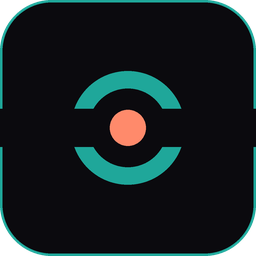
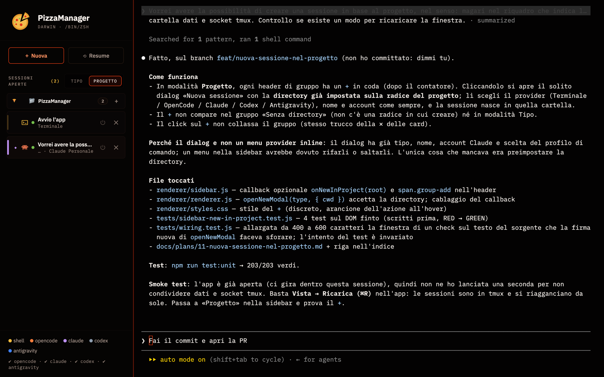

<p align="center">
  <b>🇮🇹 Italiano</b> ·
  <a href="README.en.md">🇬🇧 English</a>
</p>

<p align="center">
  
</p>

<h1 align="center">PizzaManager</h1>

<p align="center">
  Tutte le tue sessioni di Claude Code, Codex, OpenCode e terminale in una finestra sola.<br>
  Ogni scheda è un terminale vero. Con tmux, le sessioni sopravvivono anche alla chiusura dell'app.
</p>

<p align="center">
  <a href="#installazione">Installazione</a> ·
  <a href="#cosa-fa">Cosa fa</a> ·
  <a href="#guida-rapida">Guida rapida</a> ·
  <a href="#configurazione">Configurazione</a> ·
  <a href="#quando-qualcosa-non-va">Problemi</a> ·
  <a href="#sviluppo">Sviluppo</a>
</p>

<p align="center">
  <a href="https://github.com/ale-cadei/PizzaManager/releases/latest"></a>
  <a href="https://github.com/ale-cadei/PizzaManager/actions/workflows/ci.yml"></a>
  
  
  <a href="LICENSE"></a>
</p>

<p align="center">
  
</p>

Se lavori con più agenti AI da terminale, finisci con dieci finestre aperte, nessuna che dice cosa sta facendo, e ogni tanto una che chiudi per sbaglio a metà lavoro. PizzaManager le mette in una finestra sola, con una sidebar che ti dice **quale agente, in quale progetto, e se ha finito**. Nessun account, nessun servizio in mezzo: gira sul tuo computer e lancia i binari che hai già installato.

|  |  |
|---|---|
| 🍕 **Un posto per tutto** | Terminale, [Claude Code](https://github.com/anthropics/claude-code), [Codex](https://github.com/openai/codex), [OpenCode](https://opencode.ai) e [Antigravity](https://antigravity.google) in schede, con l'icona di ciascuno |
| 🔥 **Le sessioni non muoiono** | Con `tmux` ogni sessione vive fuori dall'app: chiudi la finestra, riapri, è ancora lì. Dopo un riavvio del computer ti propone di ripristinarle |
| 🗂 **Raggruppate come pensi** | Per agente o per progetto (la radice del repository). Il `+` di un progetto apre una sessione nuova direttamente lì |
| 🔔 **Sai quando ha finito** | Una scheda in secondo piano lampeggia quando l'agente smette di scrivere, e può seguire una notifica di sistema: il turno è tuo |
| ◫ **Due alla volta** | Due sessioni a schermo diviso, affiancate o una sopra l'altra |
| 📝 **Editor e notebook** | Una scheda con l'albero del progetto e l'editor di VS Code (Monaco); i notebook Jupyter si aprono, si modificano e si eseguono |
| 🌿 **Git e worktree** | Mappa dei branch, cambio di branch, e una sessione in un `git worktree` tutto suo: due agenti sullo stesso repository non si pestano più i file |
| 👁 **Cosa ha cambiato** | Un pannello col `diff` di quello che l'agente ha toccato, aggiornato mentre lavora; stage, commit e conflitti senza terminale |
| ⟲ **Resume** | Riprendi una conversazione di Claude, Codex, OpenCode o Antigravity dal suo elenco, col titolo giusto, e cerca nel testo di quelle passate |
| 👤 **Più account Claude** | Login OAuth più chiavi API aggiuntive, o profili separati con `CLAUDE_CONFIG_DIR`; scegli a ogni sessione |
| ⚙️ **Comandi tuoi** | Per ogni tipo puoi definire più comandi di avvio (`claude --model opus`, variabili d'ambiente, ecc.) |

## Installazione

### Scarica

| | | |
|---|---|---|
| **macOS** | [Apple Silicon (.dmg)](https://github.com/ale-cadei/PizzaManager/releases/latest/download/PizzaManager-mac-arm64.dmg) · [Intel (.dmg)](https://github.com/ale-cadei/PizzaManager/releases/latest/download/PizzaManager-mac-x64.dmg) | Trascina l'app in *Applicazioni* |
| **Linux** | [AppImage](https://github.com/ale-cadei/PizzaManager/releases/latest/download/PizzaManager-linux-x86_64.AppImage) · [.deb](https://github.com/ale-cadei/PizzaManager/releases/latest/download/PizzaManager-linux-amd64.deb) | `chmod +x` l'AppImage, o `sudo dpkg -i` il .deb |
| **Windows** | `PizzaManager-win-x64-setup.exe` dalle [Releases](https://github.com/ale-cadei/PizzaManager/releases): l'ultima che lo contiene | installer non firmato; sessioni persistenti con psmux, già incluso (vedi [Su Windows](#su-windows)) |

Tutte le versioni: [Releases](https://github.com/ale-cadei/PizzaManager/releases). Windows esce solo quando i suoi test passano: se l'ultima release non ce l'ha, il pacchetto è nella precedente, e l'app già installata salta direttamente alla prossima che lo contiene. Le CLI (`claude`, `codex`, `opencode`) vanno installate a parte: l'app lancia quelle che trova nel PATH.

Non sai che Mac hai? → *Informazioni su questo Mac*: se dice «Apple M…» prendi **arm64**, se dice «Intel» prendi **x64**. Su Linux conviene l'**AppImage**: è l'unico formato che si aggiorna da solo (il `.deb` lo aggiorna `apt`).

Nella pagina delle Releases ci sono anche file `.zip`, `.blockmap` e `latest*.yml`: non sono per te, servono all'app per aggiornarsi.

### Alla prima apertura

- **macOS**: niente da fare. Il `.dmg` è firmato con un Developer ID e notarizzato da Apple, quindi si apre come qualsiasi app scaricata.
- **Linux**: niente da fare.
- **Windows**: il pacchetto non è firmato, quindi compare l'avviso SmartScreen — *Ulteriori informazioni → Esegui comunque*.

### Si aggiorna da solo

Non serve tornare qui. L'app controlla da sola se c'è una versione nuova, la scarica mentre lavori e te lo dice **quando ha finito**: il banner in alto dice che la nuova versione è pronta, e *Riavvia ora* ci mette due secondi perché il pacchetto è già sul disco. Le sessioni aperte tornano dov'erano. Se non è il momento, *Più tardi* lo chiude e lo ritrovi la volta dopo.

Due eccezioni: col `.deb` gli aggiornamenti restano ad `apt` (il banner lo dice e apre questa pagina), e su Windows arrivano solo con le release che contengono Windows. La versione installata è in **Help → Informazioni su PizzaManager**.

### Dal sorgente

Serve se vuoi modificare l'app o provare `main` prima di una release. Un'app costruita così **non si aggiorna da sola**: è voluto, è come la usiamo noi due mentre la sviluppiamo.

#### Cosa serve

| | Obbligatorio | Consigliato |
|---|---|---|
| **Tutti** | [Node.js](https://nodejs.org) 22 o più recente | Almeno uno fra `claude`, `codex`, `opencode`, `agy` nel PATH |
| **macOS** | Xcode Command Line Tools (`xcode-select --install`, per compilare `node-pty`) | `brew install tmux` |
| **Linux** | `build-essential` e `python3` (per `node-pty`) | `sudo apt install tmux` (o l'equivalente della tua distro) |
| **Windows** | niente altro: `node-pty` usa i suoi binari precompilati | `npm run fetch:psmux` |

Senza `tmux` l'app funziona lo stesso: le sessioni però muoiono con la finestra. Su Windows `tmux` non serve: l'app porta con sé [psmux](https://github.com/psmux/psmux), che fa la stessa cosa. Il pacchetto lo contiene già; da sorgente lo scarica `npm run fetch:psmux` (una volta, con lo SHA-256 verificato).

Per **eseguire** i notebook serve anche Python con `jupyter_client` e `ipykernel` (`pip install jupyter_client ipykernel`); per aprirli e modificarli no.

#### Avvio

```bash
git clone https://github.com/ale-cadei/PizzaManager.git
cd PizzaManager
npm install
npm start
```

`npm install` compila `node-pty` per la tua piattaforma: è l'unico passaggio che può fallire, e quasi sempre perché manca il compilatore (tabella sopra).

#### Installarla come app vera

```bash
npm run install:mac   # macOS: costruisce PizzaManager.app e la copia in /Applications
npm run install:win   # Windows: costruisce il setup e installa in %LOCALAPPDATA%\Programs, con il collegamento nel menu Start
npm run dist          # qualsiasi sistema: i pacchetti della piattaforma corrente in dist/
```

Un'app costruita in locale si apre senza avvisi (Gatekeeper controlla solo i file scaricati). Ricordati di rifarla dopo ogni aggiornamento del codice: è una fotografia di quel momento. E non tenerla aperta insieme a `npm start`: sarebbero due client sulle stesse sessioni tmux.

## Cosa fa

### Sessioni

Ogni scheda è un terminale vero ([node-pty](https://github.com/microsoft/node-pty) + [xterm.js](https://xtermjs.org)): le TUI a schermo intero, i colori a 24 bit e le scorciatoie funzionano come nel terminale di sistema. **Nuova** (`⌘N` / `Ctrl+N`) chiede tipo, nome e directory di lavoro; le directory usate di recente sono a un click. Oltre ai terminali, fra i tipi ci sono **Editor** e **Git** (sotto).

La dimensione del testo si cambia da **Vista** (`⌘+` / `⌘-` / `⌘0`, o `Ctrl` altrove), vale per tutte le schede e resta memorizzata.

Il nome della scheda si assegna da solo: la prima riga che digiti, oppure il titolo che l'agente dà alla conversazione appena lo salva. Il nome scelto in **Nuova** arriva anche alla CLI (a Claude con `--name`, e a OpenCode). Doppio click sulla scheda per rinominarla; il nome resta anche dopo un riavvio, e Claude lo riceve al prossimo resume.

### Le sessioni sopravvivono all'app

Con `tmux` installato ogni sessione vive nel server tmux di PizzaManager (socket dedicato `aisession`, così non tocca le tue sessioni tmux personali). L'app è solo un client attaccato:

- **✕** stacca la scheda: il processo continua, lo ritrovi alla riapertura.
- **⏻** termina davvero.
- Dopo un **riavvio del computer** l'app sa cosa c'era aperto e propone di ripristinarlo: le conversazioni con un id noto ripartono con `--resume`, le altre come sessioni nuove nella stessa directory.

Puoi anche attaccarti da un terminale qualsiasi: `tmux -L aisession ls`.

### Sidebar

Due modi di raggruppare, con un interruttore: **per tipo** (Claude, Codex, …) o **per progetto**, cioè per radice del repository. I gruppi si aprono e chiudono; le schede si riordinano trascinandole. In modalità progetto ogni gruppo ha un `+` che apre il dialog con la directory già impostata, e **⤒** porta un gruppo in cima alla lista. La sidebar intera si chiude a una colonna di icone, per lasciare spazio al terminale.

La casella sotto **Nuova** e **Resume** cerca nei messaggi delle chat Claude Code e Codex aperte e nella cronologia visibile delle shell; un clic sul risultato porta alla scheda. Ogni risultato mostra il tipo e il suo logo, e puoi aprire tutte le occorrenze trovate. La ricerca in **Resume** continua a cercare anche nelle conversazioni chiuse e permette di espandere le occorrenze. Gli spazi nella query contano: `git ` trova `git `, ma non `github`.

Una scheda in secondo piano **lampeggia** quando l'agente ha smesso di scrivere da un secondo e mezzo (o ha suonato il campanello): non serve andare a controllare. Dal menu **Vista** si accende anche la notifica di sistema.

Una barra mostra **quanto hai consumato** nella finestra di 5 ore e nella settimana, e quanto manca al reset: per Claude è la stessa quota di `/usage`, per account; per Codex quella che scrive nei suoi log.

### Schermo diviso

Trascina una scheda su un bordo dell'area e le due sessioni si affiancano (o si impilano). La linea in mezzo si trascina, doppio click la rimette a metà; ⇄ scambia, ✕ toglie. Al riavvio la divisione si ricompone.

### Editor e notebook

Una scheda **Editor** apre un progetto con l'albero dei file a sinistra e [Monaco](https://microsoft.github.io/monaco-editor/), l'editor di VS Code, a destra:

- più file in **Aperti**, `Ctrl+P` per andare a un file, un filtro sull'albero, le lettere di git accanto ai file;
- le righe cambiate rispetto all'ultimo commit segnate nel margine e nella barra di scorrimento; in fondo alla riga del cursore, chi l'ha toccata e quando;
- `Ctrl+click` (`⌘+click` su Mac) va alla definizione; una barra di stato con posizione, spazi, codifica, fine riga e linguaggio;
- commenti sulle righe, da copiare come prompt per l'agente;
- i markdown si vedono resi, con «▤ Anteprima» / «{ } Sorgente» in testata;
- file e cartelle si copiano dentro trascinandoli dal Finder o dal file manager.

Un `.ipynb` si apre come **notebook**: markdown, codice colorato, output di testo, immagini e tabelle. Si modifica coi tasti di Jupyter (`A`/`B`, `D D`, `M`/`Y`/`R`, `Z`, `Invio`) e si **esegue**: `Ctrl+Invio` la cella, `Shift+Invio` la cella e poi la successiva, «Esegui tutto», ■ interrompe, ↻ riavvia il kernel. Il file resta nel formato di Jupyter. Senza Python con `jupyter_client` e `ipykernel` la barra del notebook dice cosa installare, e il resto funziona lo stesso.

### Git, worktree e modifiche

Una scheda **Git** mostra la mappa dei branch di un repository e permette di cambiare branch, o di unirne uno qualsiasi in quello corrente.

Dal gruppo di un progetto puoi aprire una sessione in un **worktree**: una cartella e un branch suoi, sullo stesso repository. Così due agenti sullo stesso progetto non si pestano i file, e un `git switch` dell'uno non cambia i file sotto i piedi all'altro. Il worktree compare in sidebar sotto il progetto, con il suo ⟲ per riprendere solo le sue chat; a lavoro finito lo **unisci**, lo **tieni** come branch per una PR, o lo **butti**.

Il pannello **Modifiche** mostra il `diff` di quello che l'agente ha toccato, aggiornato mentre lavora: staged e non staged, stage, unstage e commit, scartare un file (con Annulla), aprirlo nell'editor alla prima riga cambiata. Un merge, rebase, cherry-pick o revert rimasto a metà passa in modalità **Conflitti**: i blocchi si vedono nell'editor e si sceglie con un clic quale tenere, poi «Concludi merge» (o «Continua» per un rebase), o si annulla.

### Resume

**Resume** elenca le conversazioni salvate da ogni CLI, con titolo, directory e data, e le riapre con il comando di resume giusto:

| | Dove le legge | Come riapre |
|---|---|---|
| Claude Code | `~/.claude/projects/**/*.jsonl` | `claude --resume <id>` |
| Codex | `~/.codex/sessions/**/rollout-*.jsonl` | `codex resume <id>` |
| OpenCode | `opencode session list --format json` | `opencode --session <id>` |
| Antigravity | `~/.gemini/antigravity-cli/conversations` | `agy --conversation <id>` |
| Cronologia | le ultime 200 aperture dall'app | stesso comando, stessa directory |

### Account Claude

Il login OAuth corrente viene rilevato da solo. Puoi aggiungere account con **chiave API** (⚙ nel dialog): le chiavi restano sul tuo disco, in un file leggibile solo da te, e arrivano al processo solo come `ANTHROPIC_API_KEY`. Se vuoi due login OAuth davvero separati (lavoro / personale), definisci un comando con `CLAUDE_CONFIG_DIR=~/.claude-personal claude`: PizzaManager riconosce il profilo e lo mostra in sidebar.

### Comandi configurabili

`File → Configurazione comandi…` (`⌘,` / `Ctrl+,`). Per ogni tipo di sessione puoi avere più comandi: nome, riga di comando, argomenti di resume con il segnaposto `{id}`. Con più comandi per tipo, all'avvio ti chiede quale. Le variabili in testa (`VAR=valore comando`) e `$VAR` negli argomenti si espandono; `~` pure.

I comandi vengono eseguiti **senza shell**: niente pipe, redirezioni o alias. Se hai un alias in `.zshrc`, riscrivilo per esteso nel profilo.

## Guida rapida

1. **Nuova** → scegli *Claude*, una directory con un `.git`, conferma.
2. Scrivi il primo prompt: la scheda prende quel nome.
3. Passa a **Progetto** nella sidebar: la scheda è nel gruppo del repository. Premi il `+` del gruppo per aprire un terminale nella stessa directory.
4. Chiudi l'app. Riaprila: con `tmux` la sessione è ancora lì, con Claude a metà risposta.
5. **Resume** → *Claude*: la conversazione è in elenco, anche se l'hai iniziata dal terminale e non da qui.

## Configurazione

Tutto sta nella cartella dati dell'app, che **non cambia** anche se l'app viene rinominata:

| Sistema | Cartella |
|---|---|
| macOS | `~/Library/Application Support/AISessionManager` |
| Linux | `~/.config/AISessionManager` |
| Windows | `%APPDATA%\AISessionManager` |

| File | Contenuto |
|---|---|
| `command-profiles.json` | i comandi di avvio (modificabile anche dalla UI) |
| `claude-accounts.json` | gli account a chiave API — permessi `600` |
| `sessions-history.json` | le ultime 200 sessioni aperte (per Resume e directory recenti) |
| `live-sessions.json` | specchio delle sessioni tmux vive, per il ripristino dopo un riavvio |

### Cosa passa dalla rete

Niente telemetria e nessun account. Le richieste che l'app fa da sé sono queste, e nessuna manda i tuoi file o le tue conversazioni:

- i **font** (IBM Plex Mono e IBM Plex Sans da Google Fonts; offline usa quelli di sistema);
- il **controllo degli aggiornamenti** sulle Releases di GitHub, 10 secondi dopo l'avvio e poi ogni 4 ore;
- la **quota di Claude** per la barra del consumo, chiesta ad Anthropic col token che la CLI ha già salvato (al massimo ogni 5 minuti per account);
- l'elenco del pannello **Segnalazioni**, letto dal repository su GitHub.

Tutto il resto sono le connessioni delle CLI che avvii.

### Su Windows

Funziona con PowerShell come terminale e con le CLI installate via `npm i -g` (`claude.cmd`, `codex.cmd`) o con l'installer nativo di Claude. Differenze rispetto a macOS/Linux:

- al posto di `tmux` c'è [psmux](https://github.com/psmux/psmux), nel pacchetto: chiudere l'app stacca le sessioni e riaprirla le riaggancia, e dopo un riavvio del PC si ripropongono (Claude con `--resume`, PowerShell con il testo di prima). Rispetto a macOS la barra di scorrimento va un po' a scatti, l'ultima riga del terminale resta vuota, e in PowerShell Ctrl+B compare come `^B`;
- Antigravity CLI non è distribuita per Windows;
- il file delle chiavi API non ha permessi `600` (su Windows contano le ACL della cartella utente).

## Quando qualcosa non va

**«Binario `claude` non trovato nel PATH».** Le app avviate dal Finder o dal menu non ereditano il PATH della tua shell. PizzaManager lo chiede alla shell di login e cerca nei posti tipici (nvm, volta, Homebrew, `~/.local/bin`, `%APPDATA%\npm`), ma se il tuo è altrove scrivi il percorso completo nel comando (`File → Configurazione comandi…`). Il tooltip della legenda in basso a sinistra dice dove ha cercato.

**Il comando funziona nel terminale ma non qui.** Probabilmente è un alias o una funzione di shell: qui i comandi girano senza shell. Riscrivilo per esteso, variabili comprese.

**L'app dice «node-pty non installato».** Su macOS e Linux `npm install` ricompila `node-pty` per Electron e, se manca il compilatore, lo segnala senza fermarsi: installa Xcode CLT (macOS) o `build-essential` (Linux), poi `npm run postinstall`. Su Windows non si ricompila niente: riesegui `npm install`.

**Le sessioni spariscono chiudendo l'app.** `tmux` non è installato o non è nel PATH; la legenda in basso lo dice. Dopo averlo installato riavvia l'app. Su Windows la legenda dice psmux: se è spento, l'exe del pacchetto non è partito, e di solito è l'antivirus ad averlo bloccato (`%LOCALAPPDATA%\PizzaManager\psmux`).

**Una barra verde in fondo al terminale, e Ctrl+B non arriva all'applicazione.** È la barra di stato di tmux con la configurazione di default: il server è partito senza la config dell'app (versioni fino alla 1.0.0 impacchettate, o un `tmux -L aisession attach` fatto a mano a server spento). Aggiorna l'app: ora riapplica la sua configurazione a ogni sessione nuova. Nel frattempo, ad app chiusa, `tmux -L aisession kill-server`.

**Una sessione tmux resta appesa.** `tmux -L aisession ls` per vederle, `tmux -L aisession kill-session -t <nome>` per una sola. Mai `kill-server` senza `-L aisession`: colpiresti le tue sessioni personali.

**Il banner dell'aggiornamento non compare mai.** Il primo controllo parte 10 secondi dopo l'avvio e poi ogni 4 ore: se hai appena aperto l'app, aspetta un attimo. Col `.deb` e con un'app costruita da sorgente non compare, di proposito.

**Un notebook non si esegue.** La barra del notebook dice cosa manca: di solito `pip install jupyter_client ipykernel` nel Python che l'app trova nel PATH.

## Segnalazioni e richieste

Problemi e idee vanno nelle [Issues](https://github.com/ale-cadei/PizzaManager/issues). Le più votate (👍 sulla issue) si guardano per prime, e quando ci stiamo lavorando hanno l'etichetta *In corso*.

L'app ha lo stesso elenco nel pannello **📣 Segnalazioni**, in basso a destra: vedi a cosa stiamo lavorando e apri una segnalazione con versione e sistema già compilati.

## Sviluppo

```
main.js        solo cablaggio: handler IPC, store, avvio
lib/           logica pura, senza Electron — è ciò che si testa
app/           finestra, menu, ciclo di vita dei pty, config tmux
renderer/      la UI (sandboxed, parla col main solo via preload.js)
tests/         node --test, nessun framework
docs/plans/    un piano per branch
```

```bash
npm run test:unit       # tutti i test (~25 s)
npm run test:coverage   # con la copertura di Node
```

I test girano in CI a ogni push e PR (`.github/workflows/ci.yml`). Una **release** si fa con un tag: `git tag v1.1.0 && git push --tags` avvia `.github/workflows/release.yml`, che costruisce i pacchetti su macOS, Linux e Windows e li allega a una bozza di Release su GitHub, da pubblicare dopo un'occhiata. La procedura intera è in [`docs/rilasci/`](docs/rilasci/README.md).

I test importano il codice vero e girano anche i casi Windows da macOS/Linux, iniettando `platform: 'win32'`. Le convenzioni (dove va un pezzo di codice, regole su tmux, sicurezza, percorsi) sono in [`CLAUDE.md`](CLAUDE.md); il lavoro in corso e quello fatto in [`docs/plans/`](docs/plans/README.md).

## Licenza

[MIT](LICENSE): puoi usare, modificare e ridistribuire PizzaManager, anche dentro altri progetti, a patto di conservare l'avviso di copyright e la licenza.

PizzaManager si appoggia a lavoro di altri, e lo ringraziamo: [xterm.js](https://xtermjs.org) e [node-pty](https://github.com/microsoft/node-pty) per i terminali, [Monaco](https://microsoft.github.io/monaco-editor/) per l'editor, [Electron](https://www.electronjs.org), [tmux](https://github.com/tmux/tmux) su macOS e Linux e [psmux](https://github.com/psmux/psmux) su Windows (incluso nel pacchetto Windows) per le sessioni che sopravvivono all'app. Tutti i componenti che l'app impacchetta, con le loro licenze, sono in [`THIRD-PARTY-NOTICES.md`](THIRD-PARTY-NOTICES.md). I nomi e i loghi dei prodotti che l'app lancia (Claude Code, Codex, OpenCode, Antigravity…) appartengono ai rispettivi proprietari.

Copyright © 2026 Giacomo Grieco e Alessandro Cadei.
